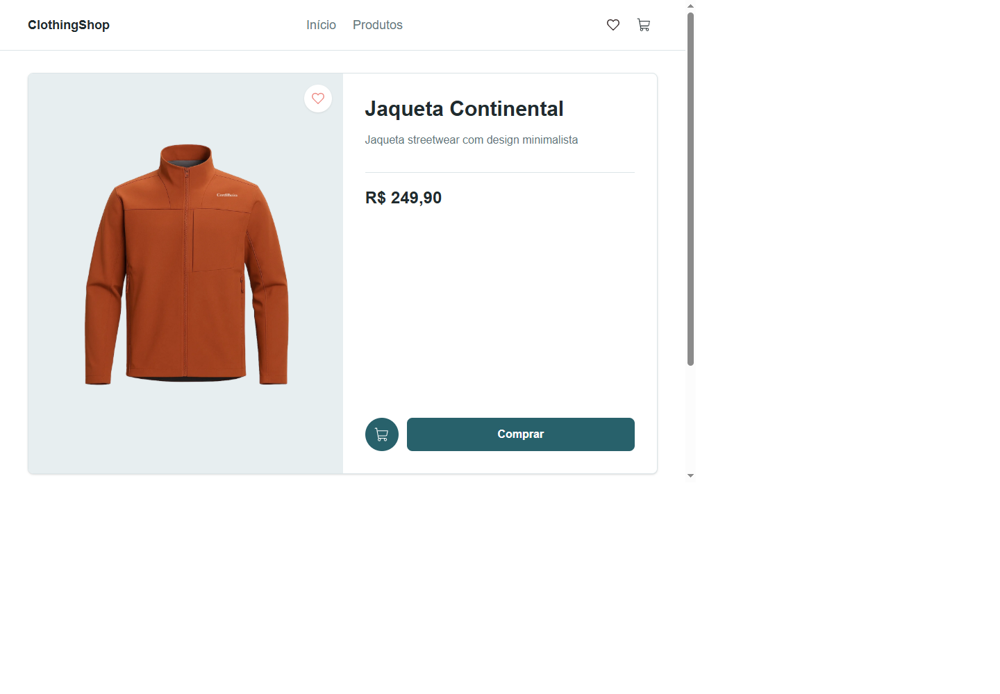

# ClothingShop

<p align="center">
  Uma vitrine de moda responsiva com catálogo de peças e páginas de produto.
</p>

<p align="center">
  Next.js 16 · React 19 · TypeScript · Tailwind CSS 4
</p>

[Telas](#telas) · [Funcionalidades](#funcionalidades) · [Tecnologias](#tecnologias) · [Como executar](#como-executar) · [Estrutura](#estrutura)

## Telas

## Funcionalidades

### Página inicial

- Catálogo responsivo com seis produtos definidos em `app/items/itemsInfo.ts`.
- Página de detalhes por produto em `/clothes/[id]`.
- Botão de favorito com alternância visual.
- Navegação entre a página inicial e a lista de produtos.

> [!NOTE]
> Os favoritos mantêm apenas estado local. Carrinho e compra ainda não têm fluxo funcional. As fotos dos produtos vêm de URLs externas e precisam de conexão com a internet.

<p align="center">
  
- [Next.js 16.4](https://nextjs.org/) com App Router
- [React 19.3](https://react.dev/)
- [TypeScript 5](https://www.typescriptlang.org/)
- [Tailwind CSS 4](https://tailwindcss.com/)
- [React Icons 5](https://react-icons.github.io/react-icons/)
- Página individual de produto em `/clothes/[id]`.
- Botão de favorito com alternância visual local.
- Imagens de produto carregadas de URLs externas.
Pré-requisitos: Node.js e npm instalados.
> Carrinho e compra ainda são elementos visuais, sem fluxo de checkout implementado.

## Tecnologias

- [Next.js 16](https://nextjs.org/) com App Router
- [React 19](https://react.dev/)
  Abra [http://localhost:3000](http://localhost:3000) no navegador. O catálogo não precisa de configuração de ambiente.
- [Tailwind CSS 4](https://tailwindcss.com/)
- [React Icons](https://react-icons.github.io/react-icons/)

| Comando         | Descrição                            |
| --------------- | ------------------------------------ |
| `npm run dev`   | Inicia o servidor de desenvolvimento |
| `npm run lint`  | Executa o ESLint                     |
| `npm run build` | Gera a build de produção             |
| `npm run start` | Inicia a aplicação compilada         |

npm run dev

````

Abra [http://localhost:3000](http://localhost:3000) no navegador.

## Comandos

| Comando         | Descrição                            |
| --------------- | ------------------------------------ |
| `npm run dev`   | Inicia o servidor de desenvolvimento |
| `npm run lint`  | Executa o ESLint                     |
| `npm run build` | Gera a build de produção             |
| `npm run start` | Inicia a aplicação em produção       |

## Estrutura

```text
app/
├── Components/
│   ├── Card/
│   ├── Container/
│   ├── FavoriteButton/
│   ├── Footer/
│   └── Heading/
├── clothes/[id]/page.tsx
├── items/itemsInfo.ts
├── globals.css
├── layout.tsx
└── page.tsx
public/
├── imagem.png
├── readme-home.png
└── readme-product.png
````
